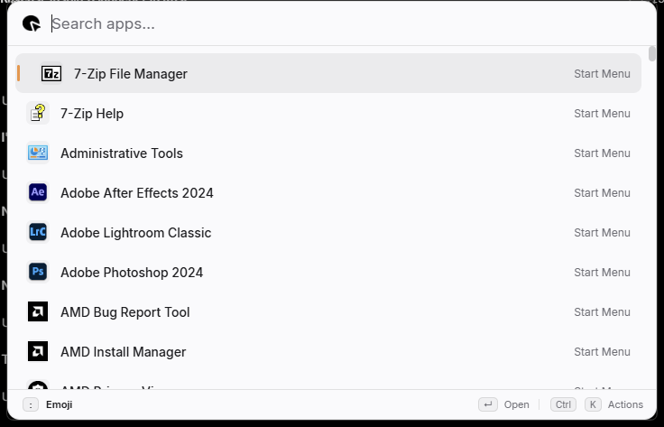
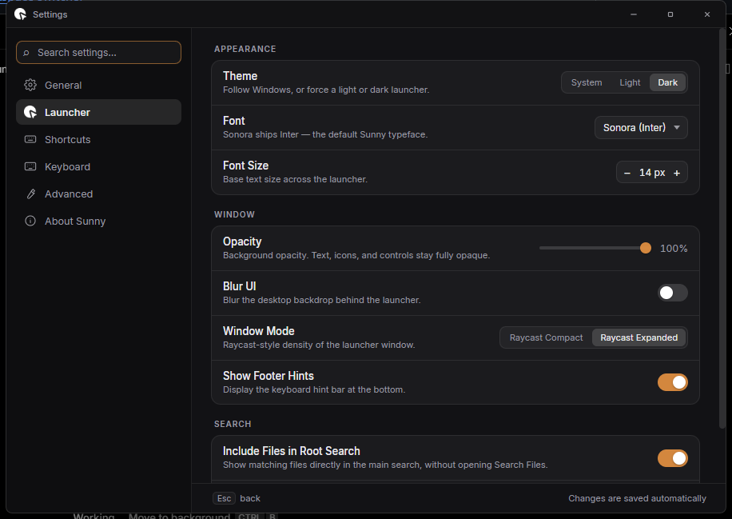

<div align="center">


<br />

**A fast, lightweight launcher for Windows.** Press <kbd>Alt</kbd>+<kbd>Space</kbd> anywhere.

[](https://github.com/aliplfrh/sunny/releases/latest)
[](https://github.com/aliplfrh/sunny/releases)
[](LICENSE)
[](https://github.com/aliplfrh/sunny/releases/latest)
[](https://tauri.app)

[**Download**](https://github.com/aliplfrh/sunny/releases/latest) · [Roadmap](docs/ROADMAP.md) · [Contributing](CONTRIBUTING.md) · [Agent guide](AGENTS.md)

</div>

---

Sunny is a command palette for Windows in the spirit of [Raycast](https://www.raycast.com/): one
keystroke away, keyboard-first, and fast enough that you stop thinking about it. It is a Rust port of
[Vicinae](https://github.com/vicinaehq/vicinae)'s core ideas — the behaviour is ported, the
implementation is new.

It is deliberately small: a single ~10 MB executable, no Electron, no background services you did not
ask for, no account, no telemetry.

<br />

<div align="center">
  
  <br />
  <sub><b>One search field for everything</b> — apps, files, calculations, and commands.</sub>
</div>

<br />

## Features

### 🔎 One search field for everything

Type and Sunny figures out what you mean. App names, file names, a math expression, or a command —
all in the same list, ranked by relevance. No modes to remember, no prefixes to learn.

- **Fuzzy app search** across everything in your Start Menu, with real icons
- **File search built in** — matching files appear directly in the main results
- **Calculator** — type `12*7` and the answer is the first row; press <kbd>Enter</kbd> to copy it
- **Commands** — Clipboard History, Emoji Picker, Search Files, Settings

### 📋 Clipboard history

Everything you copy, kept locally and searchable. A master–detail view shows the full content, size,
timestamp, and checksum before you paste.

- <kbd>Enter</kbd> pastes straight into the window you came from
- <kbd>Ctrl</kbd>+<kbd>B</kbd> copies without pasting, <kbd>Ctrl</kbd>+<kbd>D</kbd> deletes
- Pause recording at any time; history is capped and stored on disk

<div align="center">
  
</div>

### 😀 Emoji picker

Type `:` and search 1,870 emoji by name. <kbd>Enter</kbd> copies the one you picked.

<div align="center">
  
</div>

### 🎨 A launcher that looks like it belongs

- **Theme** — System, Light, or Dark, applied to both the launcher and Settings
- **Background-only opacity** — dim the backdrop without fading your text and icons
- **Blur** — soften the desktop behind the launcher
- **Compact or Expanded** window modes
- **Adjustable font size** and a bundled Inter typeface

<div align="center">
  
</div>

### ⚙️ A real Settings window

Settings opens as its own window, with a sidebar and a search box — not a cramped panel inside the
palette. Every change applies live, and is saved atomically so a crash can never wipe your preferences.

<div align="center">
  
</div>

### 🔄 Updates itself

Sunny checks for a new release, verifies its signature, installs it, and restarts — from
**Settings → About Sunny**. No manual downloads after the first install.

### ⌨️ Keyboard first

| Action | Shortcut |
|---|---|
| Show / hide Sunny | <kbd>Alt</kbd>+<kbd>Space</kbd> |
| Open Settings | <kbd>Ctrl</kbd>+<kbd>,</kbd> |
| Navigate results | <kbd>↑</kbd> <kbd>↓</kbd> |
| Open / run / copy | <kbd>Enter</kbd> |
| Emoji picker | <kbd>:</kbd> |
| Back to app search | <kbd>Backspace</kbd> |
| Reveal file in Explorer | <kbd>Ctrl</kbd>+<kbd>R</kbd> |
| Vim navigation (optional) | <kbd>Ctrl</kbd>+<kbd>J</kbd> / <kbd>Ctrl</kbd>+<kbd>K</kbd> |

<br />

## Install

1. Download **`Sunny_x.y.z_x64-setup.exe`** from the [latest release](https://github.com/aliplfrh/sunny/releases/latest).
2. Run it. Sunny installs **per-user** — no administrator prompt.
3. Press <kbd>Alt</kbd>+<kbd>Space</kbd>.

> **Requirements:** Windows 10 or 11 (x64). WebView2 is already present on current Windows builds.

<br />

## Status

Sunny is at **v1.0.0** — the core feature set is complete and usable day to day.

| | Feature | State |
|:--:|---|:--:|
| 🔎 | App launcher with fuzzy search and real icons | ✅ |
| 📁 | File search, open or reveal in Explorer | ✅ |
| 🧮 | Calculator | ✅ |
| 😀 | Emoji picker (1,870 emoji) | ✅ |
| 📋 | Clipboard history with paste-to-active-window | ✅ |
| ⚙️ | Separate Settings window with search | ✅ |
| 🎨 | Theme: System / Light / Dark | ✅ |
| 🔄 | Signed auto-update | ✅ |
| 🖥️ | System tray icon | ✅ |
| 🪟 | Window switcher | 🚧 planned |
| 🐧 | Linux and macOS builds | 🚧 planned |

See [docs/ROADMAP.md](docs/ROADMAP.md) for the full picture, including what is explicitly out of scope.

<br />

## Build from source

**Prerequisites**

1. [Rust](https://rustup.rs) — `stable-x86_64-pc-windows-msvc`
2. [Node.js](https://nodejs.org) ≥ 20 (only for the Tauri CLI)
3. **Visual Studio Build Tools** with the *Desktop development with C++* workload (MSVC linker + Windows SDK)

   ```powershell
   winget install --id Microsoft.VisualStudio.2022.BuildTools --override "--quiet --wait --norestart --add Microsoft.VisualStudio.Workload.VCTools --includeRecommended"
   ```

**Run it**

```powershell
cargo build --release
target\release\sunny.exe
```

**Build the installer**

```powershell
cd apps/sunny
npx @tauri-apps/cli@2 build        # → target/release/bundle/nsis
```

**Build a signed release** (installer + signature + `latest.json`)

```powershell
powershell -File scripts/release.ps1
```

**Regenerate assets**

```powershell
powershell -File scripts/make-icon.ps1     # icons from the logo pack
powershell -File scripts/make-emojis.ps1   # emojis.json from the gemoji dataset (MIT)
```

> UI files are embedded at compile time — rebuild after editing anything in `apps/sunny/ui/`.

<br />

## Architecture

Sunny is three layers, and each one only knows about the layer below it.

```
apps/sunny/ui          Vanilla HTML/CSS/JS — one bundle, two windows
        │  Tauri commands
apps/sunny/src-tauri   Rust: commands, windows, tray, hotkey, background threads
        │
crates/sun-core        Pure logic: search, apps, files, clipboard, emoji, calc, settings
        │
crates/sun-platform    Windows FFI: icons, screen capture, clipboard, SendInput, ShellExecuteW
```

| Crate | Responsibility |
|---|---|
| `apps/sunny` | Tauri v2 app — the launcher and Settings windows, global hotkey, tray |
| `crates/sun-core` | Fuzzy ranking, app index, file index, clipboard store, emoji, calculator, settings |
| `crates/sun-platform` | All `unsafe` Windows code, isolated behind a safe API |

No frontend framework, no bundler, no TypeScript. The UI is `index.html`, `style.css`, and `main.js`.

<br />

## Contributing

Contributions are welcome — bug reports, fixes, docs, and ideas.

- Read [**CONTRIBUTING.md**](CONTRIBUTING.md) for the process.
- Read [**AGENTS.md**](AGENTS.md) if you are contributing with an AI agent — it is the architecture
  contract, and it exists so an agent can be productive without breaking the design.

<br />

## Support the project

Sunny is free, open source, and has no ads, telemetry, or paid tier. If it saves you time, you can
buy me a coffee — entirely optional, always appreciated.

<div align="center">

<!-- Replace the two links below with your own donation pages. -->
[](https://ko-fi.com/YOUR_HANDLE)
[](https://github.com/sponsors/YOUR_HANDLE)

</div>

Other ways to help that cost nothing: **star the repo**, report bugs, and tell someone about it.

<br />

## License

Sunny is licensed under **GPL-3.0**. See [LICENSE](LICENSE) and [NOTICE](NOTICE).

It is a derivative work of [Vicinae](https://github.com/vicinaehq/vicinae), which is also GPL-3.0.
All ported code remains under GPL-3.0.

<div align="center">
<br />
<sub>Built with Rust and Tauri. Not affiliated with Raycast or Vicinae.</sub>
</div>
