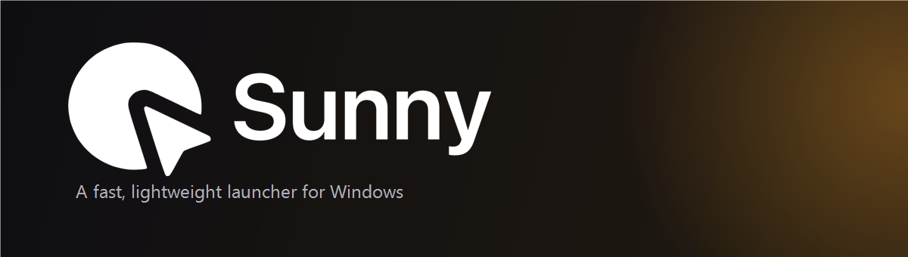
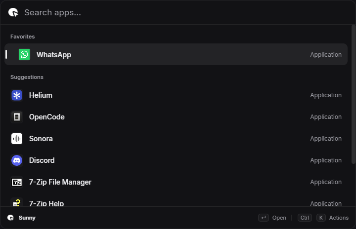

<div align="center">



**Press <kbd>Alt</kbd> + <kbd>Space</kbd> to launch an app, find a file, or paste something you copied yesterday.**

[](https://github.com/aliplfrh/sunny/releases/latest)

Windows 10 & 11 · No account · No telemetry

</div>

## Get started

Download the **x64 setup `.exe`** from the [latest release](https://github.com/aliplfrh/sunny/releases/latest) and run it. Sunny installs for your Windows user without administrator access. Press <kbd>Alt</kbd> + <kbd>Space</kbd> and start typing.

<div align="center">
  
</div>

## Try it

| Type in Sunny | What you can do |
| --- | --- |
| `term` | Open Windows Terminal if installed. Pin it to Favorites with <kbd>Ctrl</kbd> + <kbd>K</kbd>. |
| `Search Files` | Find a file, then press <kbd>Ctrl</kbd> + <kbd>K</kbd> to copy its path or show it in Explorer. |
| `Clipboard History` | Search what you’ve copied and press <kbd>Enter</kbd> to paste into the previous window. History stays on your PC. |
| `12*7` | See **84** in the results. Press <kbd>Enter</kbd> to copy it. |
| `rust ownership?` | Search the web with your chosen engine. |
| `QR Code Generator` | Turn text or a URL into a QR image and copy it locally. |

Search for **Emoji Picker** to copy an emoji by name, or type `lorem 20 words` to generate placeholder text. For **Video Download**, set up the OmniGet CLI in **Settings → General**, then choose a video or audio quality and follow progress inside Sunny.

**Make it yours.** Press <kbd>Ctrl</kbd> + <kbd>,</kbd> to open Settings. Search the current tab, adjust the theme, accent, or blur, and see changes live. Changed appearance settings have a reset button so you can undo one tweak at a time.

<details>
<summary><strong>Build from source</strong></summary>

On Windows x64, install [Rust](https://rustup.rs/) with the stable MSVC toolchain and Visual Studio Build Tools with **Desktop development with C++**. Sunny uses Tauri v2 and WebView2. From the repository root:

```powershell
cargo build --release
.\target\release\sunny.exe
```

The HTML, CSS, and JavaScript are embedded at compile time. Rebuild after editing the UI.

</details>

---

[Roadmap](docs/ROADMAP.md) · [Contributing](CONTRIBUTING.md) · [Architecture](AGENTS.md) · [Support on Saweria](https://saweria.co/aliplfrh) · [GitHub Sponsors](https://github.com/sponsors/aliplfrh)

Sunny is a [GPL-3.0](LICENSE) derivative of [Vicinae](https://github.com/vicinaehq/vicinae), with a new implementation in Rust. See [NOTICE](NOTICE) for attribution.
